<div align="center">



# 🚀 Awesome MLOps &amp; ML Pipelines ⚡

<a href="https://github.com/ishandutta2007/Awesome-Awesome-Awesome"></a><a href="https://discord.gg/jc4xtF58Ve"></a> <a href="https://github.com/ishandutta2007/Awesome-MLops-ML-Pipelines/stargazers"></a> <a href="https://github.com/ishandutta2007/Awesome-MLops-ML-Pipelines/network/members"></a> <a href="https://github.com/ishandutta2007/Awesome-MLops-ML-Pipelines/pulls"></a> <a href="https://github.com/ishandutta2007/Awesome-MLops-ML-Pipelines/blob/main/LICENSE"></a> <a href="https://github.com/ishandutta2007"></a>

**The definitive community index of Machine Learning Operations (MLOps) platforms, ML pipeline orchestrators, experiment tracking tools, model registries, and distributed compute frameworks.**

*Curated with ❤️ for Machine Learning Engineers, Platform Architects, and Data Scientists.*

</div>

---

## 📑 Table of Contents

- [🌟 Overview &amp; Key Concepts](#-overview--key-concepts)
- [🌐 Sector Overview &amp; Market Dynamics](#-sector-overview--market-dynamics)
- [🏢 Enterprise &amp; SaaS MLOps Platforms](#-enterprise--saas-mlops-platforms)
- [🔓 Open-Source MLOps &amp; Pipeline Frameworks](#-open-source-mlops--pipeline-frameworks)
  - [📊 Open-Source Quick Reference](#-open-source-quick-reference)
  - [🔍 Detailed Project Breakdowns](#-detailed-project-breakdowns)
- [🛠️ MLOps Architecture Taxonomy](#️-mlops-architecture-taxonomy)
- [❓ Frequently Asked Questions (FAQ)](#-frequently-asked-questions-faq)
- [📈 Star History](#-star-history)
- [💖 Support &amp; Community](#-support--community)
- [🤝 How to Contribute](#-how-to-contribute)
- [⚖️ Disclaimer](#️-disclaimer)

---

## 🌟 Overview &amp; Key Concepts

**MLOps (Machine Learning Operations)** bridges the chasm between experimental data science and resilient production systems. Standard software CI/CD automates code compilation and unit tests; **MLOps coordinates code, data, model artifacts, and distributed compute backends**.

A modern production ML pipeline coordinates six essential phases:
1. 🗄️ **Data &amp; Feature Engineering**: Data versioning, schema enforcement, and feature store ingestion.
2. 🔄 **Pipeline Orchestration**: Directed Acyclic Graph (DAG) dependency resolution, backfilling, and scheduling.
3. ⚡ **Distributed Training &amp; Compute**: Scaling model workloads across CPU/GPU clusters via Ray, Kubernetes, or serverless workers.
4. 🧪 **Experiment Tracking &amp; Model Registry**: Lineage tracking, parameter logging, metric visualization, and lifecycle staging.
5. 🚢 **Model Deployment &amp; Serving**: High-throughput REST/gRPC endpoints, autoscaling inference, and canary rollouts.
6. 📡 **Observability &amp; Continuous Retraining**: Data drift detection, prediction drift monitoring, and automated retraining pipelines.

---

## 🌐 Sector Overview & Market Dynamics

The global **MLOps market size** was valued at approximately **$1.7 billion in 2023** and is projected to surge to between **$14 billion and $23 billion by 2030–2032**, recording an aggressive Compound Annual Growth Rate (**CAGR of ~36% to 40%**). This exponential acceleration is propelled by enterprise adoption of Large Language Models (LLMs), Generative AI pipelines, automated retraining requirements, and stringent regulatory demands for model governance and lineage.

In terms of structure, the sector exhibits a **bi-modal, moderately fragmented market dynamic**:
- **Foundation &amp; Lakehouse Infrastructure (Concentrated)**: Foundational compute backends, storage, and unified lakehouses are heavily concentrated among hyperscalers (**AWS SageMaker**, **Microsoft Azure ML**, **Google Vertex AI**) and enterprise lakehouse pioneers (**Databricks**).
- **Specialized Pipeline &amp; MLOps Tooling (Moderately Fragmented)**: The orchestrator, experiment tracking, feature store, data testing, and observability segments remain actively fragmented. High enterprise demand for open standards, data sovereignty, and multi-cloud resilience ensures that independent SaaS providers (**Weights &amp; Biases**, **Comet ML**, **Neptune.ai**) and top-tier open-source engines (**Apache Airflow**, **Ray**, **MLflow**, **Kubeflow**, **Dagster**, **Prefect**) continuously thrive rather than yielding to a single winner-take-all monopoly.

---

## 🏢 Enterprise &amp; SaaS MLOps Platforms

The table below compiles leading hosted and SaaS MLOps platforms, **sorted in descending order by company scale (market valuation / annual revenue)**. All pricing tiers and free tier allowances reflect exact public parameters.

| 🏢 Platform | 💰 Company Scale (Valuation / Revenue) | 🏷️ Starting Tier Pricing | 🎁 Free Tier Limits | 🎯 Primary Focus &amp; Key Strengths |
| :--- | :--- | :--- | :--- | :--- |
| [**Microsoft Azure Machine Learning**](https://azure.microsoft.com/en-us/products/machine-learning/) | **~$3.12 Trillion** Market Cap (~$245.1B ARR/Rev) | **$0.096/hr** (Standard_DS1_v2 Compute Instance, 1 vCPU, 3.5 GB RAM); Serverless compute from **$0.04/vCPU-hr** | **30-day trial with $200 credits**; plus 12 months access to popular free services and 55+ services always free | Enterprise compliance via Azure Policy, deep Azure DevOps CI/CD integration, responsible AI dashboards, and automated continuous retraining triggers. |
| [**Google Cloud Vertex AI**](https://cloud.google.com/vertex-ai) | **~$2.18 Trillion** Market Cap (~$350.0B ARR/Rev) | **$0.0738/hr** (e2-standard-2 custom training); Gemini 1.5 Flash text generation from **$0.075 / 1M input tokens** | **90-day trial with $300 cloud credits** across GCP; free tier includes Vertex AI Search with 1,000 queries/month free | Unified Kubeflow Pipelines engine, first-party Gemini model access, Model Garden catalog, and AutoML across tabular, vision, and NLP tasks. |
| [**AWS SageMaker**](https://aws.amazon.com/sagemaker/) | **~$1.98 Trillion** Market Cap (~$574.8B ARR/Rev) | **$0.05/hr** (ml.t3.medium Studio Notebooks); model training starting at **$0.115/hr** (ml.m5.large instance) | **2-month free tier**: 250 hrs/month ml.t3.medium Studio Notebooks, 50 hrs/month m4.xlarge/m5.xlarge training, 125 hrs/month m4.xlarge inference | The most requested MLOps ecosystem in enterprise job listings: Pipelines, Studio, Model Registry, Endpoints, Feature Store, and Bedrock/JumpStart hubs. |
| [**Databricks**](https://www.databricks.com/) | **~$43.0 Billion** Valuation (~$2.4B ARR) | **$0.07/DBU** (Databricks Unit for Standard Jobs Compute) or **$0.15/DBU** for All-Purpose Compute + cloud provider infra | **14-day full platform free trial**; **Databricks Community Edition free forever** (1 micro-cluster, 15 GB RAM, 1 driver node) | Unified Lakehouse architecture, native MLflow experiment tracking and model registry, Delta Lake lineage, and Unity Catalog governance. |
| [**Weights &amp; Biases (W&amp;B)**](https://wandb.ai/) | **~$1.25 Billion** Valuation (~$50M+ ARR) | **$50/user/month** (Team plan billed annually) or **$60/user/month** billed monthly | **Free Forever plan** for individual practitioners: unlimited experiment tracking runs, 1 user seat, and 100 GB artifact storage | Best-in-class experiment tracking, hyperparameter sweeps, W&amp;B Weave for LLM app evaluation, and artifact lineage tracing. |
| [**Comet ML**](https://www.comet.com/) | **~$150 Million** Valuation (~$63M Funding Raised) | **$179/user/month** (Team plan billed annually) | **Free Forever Individual tier**: 1 user seat, 1 concurrent experiment execution, up to 5 GB storage, unlimited public &amp; private projects | Automated experiment logging, model production monitoring, interactive model registry, and specialized audio/computer vision visualization. |
| [**Neptune.ai**](https://neptune.ai/) | **~$50 Million** Valuation (~$13M Funding Raised) | **$49/month** (Team plan including 2 user seats, 200 monitoring hours/month) | **Free Forever Individual tier**: 1 user seat, 200 monitoring hours/month, 100 GB artifact storage, unlimited logged runs &amp; projects | Ultra-lightweight metadata registry for ML &amp; GenAI teams, run comparisons, high-throughput query API, and modular logging. |

---

## 🔓 Open-Source MLOps &amp; Pipeline Frameworks

Open-source frameworks provide data sovereignty, eliminate per-seat vendor licensing fees, and deliver transparent infrastructure control across on-premise servers and multi-cloud Kubernetes clusters.

### 📊 Open-Source Quick Reference

The table below catalogs premier open-source MLOps and pipeline projects, **strictly sorted in descending order by GitHub Stars_Count**. Each Stars_Badge links directly to that repository's official Stargazers community page.

| 📦 Repository | ⭐ GitHub Popularity | 🏷️ Primary Category | 💻 Language | 📜 License |
| :--- | :--- | :--- | :--- | :--- |
| [**Apache Airflow**](https://github.com/apache/airflow) | [](https://github.com/apache/airflow/stargazers) | General &amp; ML Workflow Orchestration | Python | Apache-2.0 |
| [**Ray**](https://github.com/ray-project/ray) | [](https://github.com/ray-project/ray/stargazers) | Distributed Compute, Training &amp; Serving | Python / C++ | Apache-2.0 |
| [**MLflow**](https://github.com/mlflow/mlflow) | [](https://github.com/mlflow/mlflow/stargazers) | Experiment Tracking &amp; Model Registry | Python | Apache-2.0 |
| [**Prefect**](https://github.com/PrefectHQ/prefect) | [](https://github.com/PrefectHQ/prefect/stargazers) | Modern Python Workflow Orchestration | Python | Apache-2.0 |
| [**Dagster**](https://github.com/dagster-io/dagster) | [](https://github.com/dagster-io/dagster/stargazers) | Software-Defined Asset Orchestrator | Python | Apache-2.0 |
| [**DVC (Data Version Control)**](https://github.com/iterative/dvc) | [](https://github.com/iterative/dvc/stargazers) | Git-Based Data &amp; Pipeline Versioning | Python | Apache-2.0 |
| [**Kubeflow**](https://github.com/kubeflow/kubeflow) | [](https://github.com/kubeflow/kubeflow/stargazers) | Cloud-Native Kubernetes ML Toolkit | Go / Python | Apache-2.0 |
| [**Great Expectations**](https://github.com/great-expectations/great_expectations) | [](https://github.com/great-expectations/great_expectations/stargazers) | Data Pipeline Testing &amp; Quality Validation | Python | Apache-2.0 |
| [**Kedro**](https://github.com/kedro-org/kedro) | [](https://github.com/kedro-org/kedro/stargazers) | Production Data Science Pipelines | Python | Apache-2.0 |
| [**Metaflow**](https://github.com/Netflix/metaflow) | [](https://github.com/Netflix/metaflow/stargazers) | Human-Centric ML Framework (Netflix) | Python / R | Apache-2.0 |
| [**BentoML**](https://github.com/bentoml/BentoML) | [](https://github.com/bentoml/BentoML/stargazers) | Model Serving &amp; Inference Infrastructure | Python | Apache-2.0 |
| [**Evidently AI**](https://github.com/evidentlyai/evidently) | [](https://github.com/evidentlyai/evidently/stargazers) | Model Evaluation &amp; Drift Monitoring | Python | Apache-2.0 |
| [**Flyte**](https://github.com/flyteorg/flyte) | [](https://github.com/flyteorg/flyte/stargazers) | Production Kubernetes Workflow Engine | Python / Go | Apache-2.0 |
| [**Feast**](https://github.com/feast-dev/feast) | [](https://github.com/feast-dev/feast/stargazers) | Real-Time &amp; Batch ML Feature Store | Python / Go | Apache-2.0 |
| [**ClearML**](https://github.com/clearml/clearml) | [](https://github.com/clearml/clearml/stargazers) | End-to-End MLOps Suite &amp; Orchestrator | Python | Apache-2.0 |
| [**ZenML**](https://github.com/zenml-io/zenml) | [](https://github.com/zenml-io/zenml/stargazers) | Extensible Multi-Cloud MLOps Framework | Python | Apache-2.0 |
| [**Seldon Core**](https://github.com/SeldonIO/seldon-core) | [](https://github.com/SeldonIO/seldon-core/stargazers) | Kubernetes Machine Learning Deployment | Python / Go | Apache-2.0 |
| [**Flowdapt**](https://github.com/emergentmethods/flowdapt) | [](https://github.com/emergentmethods/flowdapt/stargazers) | Adaptive Distributed AI Application Platform | Python | Apache-2.0 |

---

### 🔍 Detailed Project Breakdowns

#### 1. 🌪️ [Apache Airflow](https://github.com/apache/airflow) [](https://github.com/apache/airflow/stargazers)
- **Role**: Enterprise Workflow Orchestrator &amp; Multi-Backend Coordinator.
- **Highlights**: The veteran standard with the broadest ecosystem of provider integrations. Features first-class connectors for AWS SageMaker, Google Vertex AI, Databricks, MLflow, Weights &amp; Biases, and Hugging Face.
- **Architecture**: Employs Python DAGs, Celery/Kubernetes executors, and deferrable operators to keep long-running GPU training jobs from occupying worker slots.
- **Best For**: Platform engineering teams orchestrating multi-cloud pipelines across heterogeneous compute backends.

#### 2. ⚡ [Ray](https://github.com/ray-project/ray) [](https://github.com/ray-project/ray/stargazers)
- **Role**: Unified Distributed Execution Framework for AI &amp; Python.
- **Highlights**: Powers scaling for foundational models (used by OpenAI, Uber, and Amazon). Includes **Ray Train** for distributed PyTorch/TensorFlow, **Ray Data** for high-throughput streaming datasets, **Ray Tune** for hyperparameter sweeps, and **Ray Serve** for low-latency inference.
- **Architecture**: Low-overhead distributed runtime built with C++ core actors and tasks, offering near-linear scaling across thousands of GPU nodes.
- **Best For**: Distributed model training, LLM fine-tuning, and scalable reinforcement learning workloads.

#### 3. 🧪 [MLflow](https://github.com/mlflow/mlflow) [](https://github.com/mlflow/mlflow/stargazers)
- **Role**: Standard for Experiment Tracking, Model Packaging &amp; Registries.
- **Highlights**: Four foundational components: **Tracking**, **Projects**, **Models**, and **Model Registry**. Expands with MLflow 3 to deliver first-class `LoggedModel` entities, prompt registry, and hierarchical tracing for LLMs/RAG.
- **Architecture**: Lightweight Python client interacting with a backend SQL database (PostgreSQL/MySQL) and S3/GCS/Azure blob storage for model artifacts.
- **Best For**: Teams seeking zero per-seat licensing fees for reproducible experiment tracking and central model lifecycle staging.

#### 4. 🎛️ [Prefect](https://github.com/PrefectHQ/prefect) [](https://github.com/PrefectHQ/prefect/stargazers)
- **Role**: Developer-Friendly Python Workflow Orchestrator.
- **Highlights**: Simple decorator-based syntax (`@task`, `@flow`) that wraps native Python functions without requiring rigid DAG boilerplate.
- **Architecture**: Dynamic task execution graphs generated at runtime, hybrid orchestration model keeping execution within customer infrastructure, and automatic retry semantics.
- **Best For**: Python-first data teams desiring modern orchestration without the operational overhead of Airflow or Kubernetes.

#### 5. 📦 [Dagster](https://github.com/dagster-io/dagster) [](https://github.com/dagster-io/dagster/stargazers)
- **Role**: Software-Defined Asset Orchestrator for ML/AI Pipelines.
- **Highlights**: Replaces task-based DAGs with **Software-Defined Assets (SDAs)**. Models datasets, features, and model weights as assets with tracked dependencies, type-checking, and lineage.
- **Architecture**: Declarative asset definitions with built-in unit testing capabilities and seamless integrations with MLflow, dbt, and cloud compute.
- **Best For**: Asset-centric data pipelines, embedding generation, feature engineering, and RAG indexing.

#### 6. 🗂️ [DVC (Data Version Control)](https://github.com/iterative/dvc) [](https://github.com/iterative/dvc/stargazers)
- **Role**: Git-Native Data Versioning &amp; ML Pipeline Tool.
- **Highlights**: Bridges Git with cloud storage (S3, GCS, Azure Blob, Google Drive) by versioning multi-gigabyte datasets and weights via lightweight pointer files.
- **Architecture**: CLI tool operating alongside Git to build reproducible pipeline stages (`dvc.yaml`) with caching and experiment tracking.
- **Best For**: Teams wanting GitOps-style data version control without replacing existing Git repositories.

#### 7. ☸️ [Kubeflow](https://github.com/kubeflow/kubeflow) [](https://github.com/kubeflow/kubeflow/stargazers)
- **Role**: Kubernetes-Native Machine Learning Platform.
- **Highlights**: Complete toolkit featuring **Kubeflow Pipelines (KFP)**, Katib (hyperparameter tuning), and Notebook servers running natively on Kubernetes clusters.
- **Architecture**: Containers orchestrated via Kubernetes Custom Resource Definitions (CRDs); pipeline steps defined as Docker images or decorated Python functions.
- **Best For**: Organizations standardized on Kubernetes needing multi-tenant, cloud-agnostic ML pipelines.

#### 8. ✅ [Great Expectations](https://github.com/great-expectations/great_expectations) [](https://github.com/great-expectations/great_expectations/stargazers)
- **Role**: Automated Data Testing, Profiling &amp; Quality Documentation.
- **Highlights**: Prevents bad data from corrupting ML models by asserting expectations on data schemas, distributions, and null tolerances before model ingestion.
- **Architecture**: Python assertions generating human-readable "Data Docs" (HTML reports) integrated into CI/CD and orchestrator tasks.
- **Best For**: Eliminating data quality defects in upstream ETL and ML training pipelines.

#### 9. 📐 [Kedro](https://github.com/kedro-org/kedro) [](https://github.com/kedro-org/kedro/stargazers)
- **Role**: Production-Ready Data Science Framework (McKinsey / QuantumBlack).
- **Highlights**: Applies software engineering principles (modularity, pure functions, separation of data from compute) to exploratory data science code.
- **Architecture**: Data Catalog abstracting data I/O, node-and-pipeline graph construction, and automatic dependency visualization via Kedro-Viz.
- **Best For**: Transforming exploratory Jupyter notebooks into robust, deployable production pipelines.

#### 10. 🎯 [Metaflow](https://github.com/Netflix/metaflow) [](https://github.com/Netflix/metaflow/stargazers)
- **Role**: Human-Centric Python/R Framework for ML &amp; Data Science (Netflix).
- **Highlights**: Engineered specifically for data scientists. Seamlessly scales code from a local laptop to AWS Batch, Kubernetes, and Azure with simple decorators (`@step`, `@batch`).
- **Architecture**: Automatic snapshotting of code, data artifacts, and dependencies at every step for 100% reproducible execution.
- **Best For**: Data science teams wanting to scale experiments into production without learning DevOps or Kubernetes YAML.

#### 11. 🍱 [BentoML](https://github.com/bentoml/BentoML) [](https://github.com/bentoml/BentoML/stargazers)
- **Role**: Unified Model Serving &amp; Inference Pipeline Framework.
- **Highlights**: Packages models into self-contained OCI-compliant containers with built-in adaptive batching, multi-model pipelines, and GPU acceleration.
- **Architecture**: High-performance Python/Rust serving runtime with first-class support for PyTorch, TensorFlow, vLLM, and ONNX Runtime.
- **Best For**: Bridging trained models from ML pipelines to high-throughput, autoscaling production serving.

#### 12. 📊 [Evidently AI](https://github.com/evidentlyai/evidently) [](https://github.com/evidentlyai/evidently/stargazers)
- **Role**: Production Model Monitoring &amp; Drift Detection.
- **Highlights**: Over 100+ built-in statistical tests for data drift, target drift, regression/classification metric degradation, and LLM output evaluation.
- **Architecture**: Generates interactive visual dashboards and JSON reports that embed into automated retraining pipelines and alerting systems.
- **Best For**: Detecting production model degradation and initiating automated pipeline retraining.

#### 13. 🦅 [Flyte](https://github.com/flyteorg/flyte) [](https://github.com/flyteorg/flyte/stargazers)
- **Role**: Production-Grade Kubernetes Orchestrator for ML &amp; Data (Lyft Incubated).
- **Highlights**: Strongly typed, container-native workflow automation with reproducible tasks, memoization/caching, and multi-tenant resource quotas.
- **Architecture**: Golang control plane (`flyteadmin`, `flytepropeller`) executing Kubernetes pods with deterministic inputs and outputs.
- **Best For**: Large-scale ML platforms demanding strict typed data contracts and compute caching.

#### 14. 🍽️ [Feast](https://github.com/feast-dev/feast) [](https://github.com/feast-dev/feast/stargazers)
- **Role**: Open-Source ML Feature Store for Real-Time &amp; Batch ML.
- **Highlights**: Prevents train-serve skew by providing point-in-time correct historical features for training and ultra-low-latency feature lookups for online inference.
- **Architecture**: Connects offline data stores (Snowflake, BigQuery, Redshift, DuckDB) with online low-latency stores (Redis, DynamoDB, PostgreSQL).
- **Best For**: Real-time recommendation, fraud detection, and ranking systems requiring unified feature definitions.

#### 15. 🚀 [ClearML](https://github.com/clearml/clearml) [](https://github.com/clearml/clearml/stargazers)
- **Role**: Open-Source MLOps Suite: Experiment Manager, Orchestrator &amp; Data Management.
- **Highlights**: Integrates auto-logging with just 2 lines of code. Includes an agent-based workload orchestrator that dynamically launches compute tasks on remote machines.
- **Architecture**: Modular server architecture featuring Web UI, REST API, and dynamic worker agents for flexible on-premise and cloud execution.
- **Best For**: Small to mid-size teams wanting an all-in-one self-hosted MLOps platform without combining multiple point solutions.

#### 16. 🧘 [ZenML](https://github.com/zenml-io/zenml) [](https://github.com/zenml-io/zenml/stargazers)
- **Role**: Extensible, Open-Source MLOps Framework &amp; Stack Orchestrator.
- **Highlights**: Decouples pipeline logic from infrastructure stacks. Write code once in Python and run it locally, on Airflow, Kubeflow, or cloud platforms via stack switches.
- **Architecture**: Abstract stack components (Artifact Store, Orchestrator, Step Operator, Model Deployer) enabling modular plug-and-play MLOps.
- **Best For**: Teams wanting infrastructure-agnostic ML pipelines that migrate painlessly between clouds and orchestrators.

#### 17. 🛡️ [Seldon Core](https://github.com/SeldonIO/seldon-core) [](https://github.com/SeldonIO/seldon-core/stargazers)
- **Role**: Advanced Kubernetes Machine Learning Deployment &amp; Governance.
- **Highlights**: Manages complex inference topologies: multi-armed bandits, canary releases, shadow deployments, and inference explanation graphs.
- **Architecture**: Cloud-native operator running on Kubernetes with Istio/Envoy service mesh integration for low-latency traffic routing.
- **Best For**: Enterprise teams deploying mission-critical models into regulated Kubernetes environments.

#### 18. 🔄 [Flowdapt](https://github.com/emergentmethods/flowdapt) [](https://github.com/emergentmethods/flowdapt/stargazers)
- **Role**: Adaptive Distributed AI Application Platform.
- **Highlights**: Automated execution graph generation supporting Ray, Dask, or local execution from vanilla Python code with event-driven scheduling.
- **Architecture**: Modular reactive architecture supporting real-time data ingestion and adaptive cluster autoscaling.
- **Best For**: Many-model architectures, event-driven reactive ML, and large-scale parallel time-series forecasting.

---

## 🛠️ MLOps Architecture Taxonomy

To design a robust MLOps stack, modern teams select modular layers matching their infrastructure maturity:

```
┌────────────────────────────────────────────────────────────────────────┐
│                        MLOps PRODUCTION STACK                          │
└────────────────────────────────────────────────────────────────────────┘
  1. Data & Features       : Feast | DVC | Great Expectations
  2. Pipeline Orchestration: Apache Airflow | Dagster | Prefect | Kubeflow
  3. Compute & Training    : Ray | AWS SageMaker | Azure ML | Vertex AI
  4. Tracking & Registry   : MLflow | Weights & Biases | Comet ML | Neptune.ai
  5. Serving & Inference   : BentoML | Seldon Core | vLLM
  6. Monitoring & Drift    : Evidently AI | Azure Model Monitor | SageMaker Clarify
```

---

## ❓ Frequently Asked Questions (FAQ)

<details>
<summary><b>1. What is the fundamental difference between data pipelines and ML pipelines?</b></summary>
<br/>
Data pipelines focus on deterministic Extract, Transform, Load (ETL/ELT) operations where input records directly map to output schemas. ML pipelines are non-deterministic: they consume datasets to produce probabilistic artifacts (model weights, hyperparameter checkpoints, evaluation metrics) requiring experiment versioning, GPU acceleration, and automated drift detection.
</details>

<details>
<summary><b>2. How should my team choose between Apache Airflow, Kubeflow, and Dagster?</b></summary>
<br/>
<ul>
  <li><b>Choose Apache Airflow</b> if your enterprise already runs Airflow for general data engineering, requires multi-cloud compute scheduling, and needs integrations with hundreds of enterprise tools.</li>
  <li><b>Choose Kubeflow</b> if your infrastructure is 100% standardized on Kubernetes, and you require native multi-tenant container isolation and GitOps workflows.</li>
  <li><b>Choose Dagster</b> if you build asset-centric pipelines (dbt models, embeddings, feature tables) where lineage tracking and software-defined assets are paramount.</li>
</ul>
</details>

<details>
<summary><b>3. Should we adopt a hyperscaler SaaS platform or host open-source MLOps?</b></summary>
<br/>
Adopt <b>Hyperscaler SaaS (SageMaker, Vertex AI, Azure ML)</b> if your organization prioritizes rapid time-to-market, unified IAM/security compliance, and zero infrastructure operations. Choose <b>Open-Source (MLflow, Airflow, Ray, BentoML)</b> if data sovereignty, on-premises execution, multi-cloud flexibility, and eliminating per-seat SaaS costs are top priorities.
</details>

---

## 📈 Star History

[](https://star-history.dera.page/#ishandutta2007/Awesome-MLops-ML-Pipelines&type=date&legend=top-left)

---

## 💖 Support &amp; Community

Thank you so much for exploring and supporting **Awesome-MLops-ML-Pipelines**! If you find this directory valuable for your machine learning engineering journey, please consider supporting the project:

- ⭐ **Star this repository** to improve discoverability for other ML engineers.
- 🍴 **Fork the repo** and contribute additions, corrections, and tool updates.
- 📢 **Share the project** with your team and across social networks (LinkedIn, X/Twitter, Reddit).
- ☕ **Sponsor the Maintainer**: Support ongoing curation, reviews, and community updates via the [**GitHub Sponsor Dashboard**](https://github.com/sponsors/ishandutta2007).

---

## 🤝 How to Contribute

Contributions are warmly welcomed! Help keep this directory current, objective, and comprehensive:

1. 🍴 **Fork this repository**.
2. 🌿 **Create a new branch**: `git checkout -b feature/add-new-mlops-tool`.
3. 📝 **Add your entry** following existing tabular formatting and style guidelines.
4. 🔍 **Verify details**: Include factual pricing, documented free tier boundaries, and official GitHub links.
5. 🚀 **Submit a Pull Request** with a concise description of why the tool benefits the MLOps community.

---

## ⚖️ Disclaimer

- This catalog is a **community-curated directory** provided for educational and architectural reference — inclusion does not constitute commercial endorsement.
- Product pricing, free tier parameters, and company valuations change dynamically over time. Consult each vendor's official documentation for authoritative real-time terms.
- Self-hosted open-source software requires dedicated infrastructure management and security configuration; always conduct internal security audits prior to deploying into production environments.

---

<div align="center">
  <b>Built with passion for Machine Learning Engineers worldwide.</b><br/>
  <sub>Maintained by <a href="https://github.com/ishandutta2007">Ishan Dutta</a> and the open-source community.</sub>
</div>
